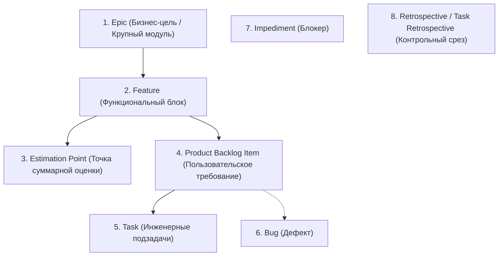
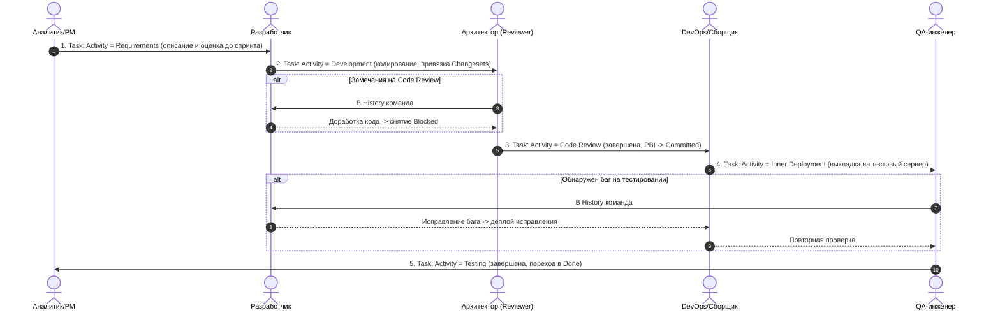
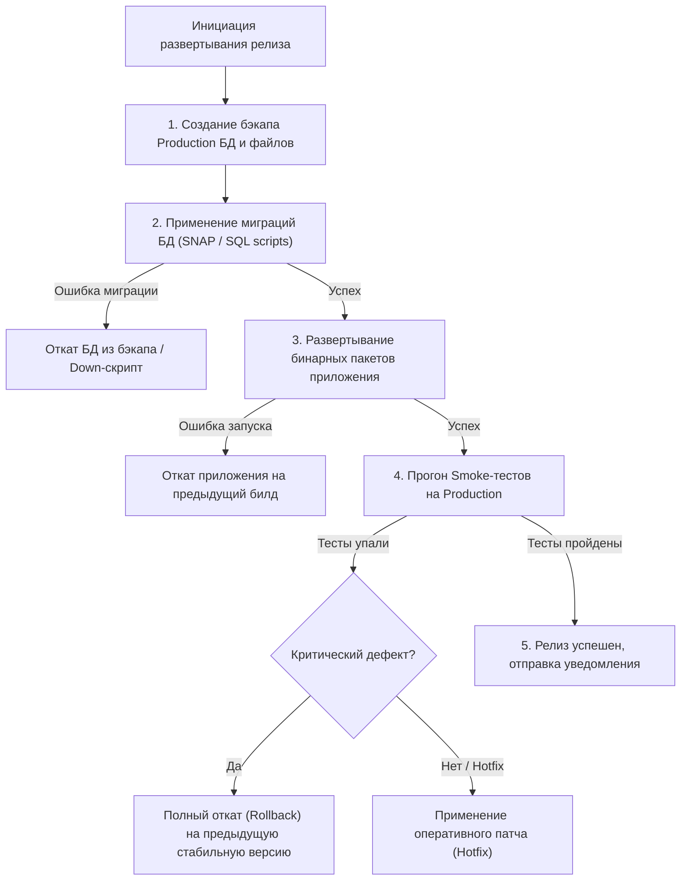

# Руководство по разработке документа-регламента процесса разработки и ввода в эксплуатацию ПО

Данный документ представляет собой полную систематизацию материалов семестрового курса лекций по дисциплине «Программная инженерия» (кафедра программной инженерии / Azure DevOps, MSF, XP, TFVC/Git) и содержит детальное руководство по составлению студенческого регламента для команды из 3–5 человек.

---

## Оглавление

1. [Общая структура и назначение регламента](#общая-структура-и-назначение-регламента)
2. [Раздел 1. Выбор и обоснование ЖЦ разработки процесса. Ролевой состав](#раздел-1-выбор-и-обоснование-жц-разработки-процесса-ролевой-состав)
3. [Раздел 2. Выбор и обоснование ЖЦ проекта](#раздел-2-выбор-и-обоснование-жц-проекта)
4. [Раздел 3. Процесс, методика и практики управления проектом](#раздел-3-процесс-методика-и-практики-управления-проектом)
5. [Раздел 4. Артефакты проекта, их иерархия и определение точки окончания задачи](#раздел-4-артефакты-проекта-их-иерархия-и-определение-точки-окончания-задачи)
6. [Раздел 5. Управление версиями, структура веток и правила слияния](#раздел-5-управление-версиями-структура-веток-и-правила-слияния)
7. [Раздел 6. Управление версионностью структуры данных хранилищ (БД)](#раздел-6-управление-версионностью-структуры-данных-хранилищ-бд)
8. [Раздел 7. Интеграция автоматизированного и ручного тестирования](#раздел-7-интеграция-автоматизированного-и-ручного-тестирования)
9. [Раздел 8. Формирование выпусков (релизов) и процедура развертывания](#раздел-8-формирование-выпусков-релизов-и-процедура-развертывания)
10. [Раздел 9. Процедура ввода в эксплуатацию (замена системы vs новая система)](#раздел-9-процедура-ввода-в-эксплуатацию-замена-системы-vs-новая-система)
11. [Чек-лист для защиты регламента перед преподавателем](#чек-лист-для-защиты-регламента-перед-преподавателем)

---

## Общая структура и назначение регламента

> [!IMPORTANT]
> **Цель этапа:** Создание нормативного документа (регламента), определяющего правила совместной инженерной работы группы из 3–5 человек при создании, тестировании, версионировании и внедрении программного продукта в среде Azure DevOps / Team Foundation Server.

В регламенте не должно быть «воды»: каждый раздел должен содержать конкретные соглашения команды, правила перехода состояний, схемы ветвления, шаблоны именования коммитов и версий, а также регламентированные действия при сбоях и конфликтах.

---

## Раздел 1. Выбор и обоснование ЖЦ разработки процесса. Ролевой состав

### 1.1. Базовые понятия
- **Жизненный цикл разработки процесса (Process Lifecycle):** Модель организации ежедневного инженерного труда команды, устанавливающая инженерные практики, способ коммуникации, регулярность сборок, методы проверки качества кода и распределение ответственности.
- **Extreme Programming (XP, Экстремальное программирование):** Гибкая легковесная методология разработки ПО, ориентированная на малые команды (до 10 человек), частые релизы, тесную обратную связь, коллективную ответственность и непрерывное улучшение качества за счет 12 ключевых практик.
- **Коллективное владение кодом (Collective Code Ownership):** Практика XP, при которой любой разработчик имеет право и обязанность вносить изменения в любой фрагмент кодовой базы для исправления ошибок или рефакторинга. Понятие «личного закрытого кода» отсутствует.
- **Парное программирование (Pair Programming):** Написание кода двумя программистами за одним рабочим местом (один пишет код — «водитель», второй непрерывно анализирует архитектуру и ошибки — «штурман»), с периодической сменой ролей.
- **TDD (Test-Driven Development):** Разработка через тестирование — тесты пишутся до написания функционального кода.
- **Continuous Integration (CI):** Частая (по нескольку раз в день) интеграция кода всех участников в общую ветку с автоматической сборкой и прогоном тестов.

### 1.2. Теоретическая основа и обоснование (Лекции 3, 4)
В задании указано особое замечание лектора: *(«если люди не ходят, лучше XP»)*. 

#### Почему при нестабильной посещаемости / рисках студентов выбирается XP:
1. **Отсутствие единой точки отказа (No Bus Factor / Single Point of Failure):** В тяжелых методологиях (RUP, Waterfall) каждый участник выполняет изолированную узкую функцию (один пишет ТЗ, второй архитектуру, третий базу данных). Если ответственный студент заболел или пропускает занятия, проект полностью блокируется. В XP благодаря *коллективному владению кодом* и *парному программированию* контекст распределен между всеми членами команды, и любой студент может подхватить задачу отсутствующего.
2. **Минимум бюрократических задержек:** Команда не тратит недели на согласование 100-страничных спецификаций. Требования формулируются в виде компактных User Stories.
3. **Автоматизированная сеть безопасности (TDD + CI):** Если студент возвращается к работе после пропуска, наличие исчерпывающего набора unit-тестов исключает риск незаметно сломать функционал, написанный коллегами.
4. **Короткие итерации (1–2 недели):** Позволяют регулярно контролировать реальный прогресс и вовремя перераспределять задачи.

### 1.3. Ролевой состав команды (3–5 человек)
В малой команде применяется принцип **совмещения ролей** (Лекция 4):

| Роль в проекте | Основные обязанности | Вариант закрепления в команде из 3–5 человек |
| :--- | :--- | :--- |
| **Менеджер проекта / Scrum Master / Трекер** | Ведение бэклога в Azure DevOps, проведение стендапов и ретроспектив, контроль сроков (Original Estimate, Remaining Work, Effort), снятие блокировок (`Impediment`). | Студент 1 (совмещает с ролью Архитектора/Аналитика) |
| **Системный архитектор / Tech Lead** | Проектирование архитектуры решения, утверждение схемы БД, проведение Code Review, контроль соблюдения стандартов кодирования. | Студент 1 или Студент 2 |
| **Разработчик (Developer)** | Реализация задач (`Activity = Development`), написание Unit-тестов, связывание коммитов/changeset с рабочими элементами TFS. | Студенты 2, 3, 4 (все участники пишут код) |
| **Инженер по качеству / Тестировщик (QA)** | Разработка тест-планов, составление тест-кейсов, ручное тестирование функционала (`Activity = Testing`), создание Bug/REVISION, автоматизация UI/API-тестов. | Студент 4 (совмещает с кодированием в других модулях) |
| **Инженер по выпуску / DevOps / Технолог** | Настройка пайплайнов сборки и деплоя, управление ветками в Source Control, подготовка миграций БД (`SNAP-файлы`), формирование Release Notes. | Студент 3 (или Студент 5 при наличии) |

### 1.4. Регламент изменения ролевого состава (матрица взаимозаменяемости)
При пропуске занятий, болезни или высокой нагрузке одного из участников действуют формализованные правила замещения:
1. **Правило передачи задач:** Если исполнитель не выходит на связь более 24 часов, Менеджер переводит его активные задачи (`Remaining Work > 0`) в статус *Unassigned* и передает запасному разработчику по матрице взаимозаменяемости.
2. **Правило Code Review при совмещении ролей (Лекция 10, стр. 2):** Если один и тот же участник является и исполнителем (`Development`), и ревьюером (`Code Review`), операция Code Review пропускается автоматически, либо задача передается независимому разработчику.
3. **Ротация пар:** В соответствии с практиками XP каждые 2–3 дня пары разработчиков меняются составом для распространения архитектурных знаний по всему коду.

---

## Раздел 2. Выбор и обоснование ЖЦ проекта

### 2.1. Базовые понятия
- **Жизненный цикл проекта (Project Lifecycle):** Макроструктура фаз и этапов проекта от момента инициации и анализа бизнес-требований до стабилизации, развертывания и передачи заказчику.
- **Отличие ЖЦ проекта от ЖЦ процесса разработки:** 
  - *ЖЦ процесса* (п. 1) регламентирует внутренний порядок микро-работ (как кодить, как мержить, XP/TDD, ежедневные стендапы).
  - *ЖЦ проекта* (п. 2) регламентирует внешние контрольные вехи (Milestones), фазы готовности всего продукта и критерии перехода между ними.
- **Модели ЖЦ (Лекция 2, 3):**
  - *Каскадная (Waterfall):* строго линейная последовательность, переход только после 100% завершения предыдущей фазы. Неприменима из-за риска ошибок в конце.
  - *V-образная (V-Model):* акцент на раннем планировании верификации и тестирования для каждого уровня требований.
  - *Спиральная (Spiral Model Боэма):* витки с обязательным анализом и снижением рисков перед каждым новым шагом.
  - *MSF Process Model (Модель процессов MSF):* фазово-итерационная модель, ориентированная на контрольные вехи (Milestones).

```mermaid
flowchart LR
    A["Фаза 1: Выработка концепции\n(Envisioning)"] -->|Веха: Концепция утверждена| B["Фаза 2: Планирование\n(Planning)"]
    B -->|Веха: Планы утверждены| C["Фаза 3: Разработка\n(Developing)"]
    C -->|Веха: Код заморожен (Scope Complete)| D["Фаза 4: Стабилизация\n(Stabilizing)"]
    D -->|Веха: Решение готово к выпуску| E["Фаза 5: Развертывание\n(Deploying)"]
    E -->|Веха: Ввод в эксплуатацию завершен| F["Эксплуатация и сопровождение"]
```

### 2.2. Обоснование выбора модели ЖЦ проекта
Для курсового проекта выбирается **Итерационно-инкрементная модель на базе Microsoft Solutions Framework (MSF Process Model)** с циклом разработки спринтами.

#### Обоснование:
1. Сочетает прозрачность и предсказуемость контрольных вех каскадной модели с адаптивностью и гибкостью спиральной/итеративной модели.
2. Идеально интегрируется с инструментами Microsoft (Azure DevOps Server / TFS, Team Foundation Version Control / Git).
3. Четко определяет 5 основных фаз и соответствующие им контрольные точки (Milestones), гарантируя поэтапную сдачу результатов преподавателю (заказчику).

### 2.3. Характеристика фаз проекта и контрольных вех

1. **Фаза выработки концепции (Envisioning):**
   - *Задачи:* анализ бизнес-проблемы заказчика, формирование проектной группы, определение границ проекта (Scope), оценка первичных рисков.
   - *Веха (Milestone):* «Концепция проекта утверждена» (Vision & Scope approved).
2. **Фаза планирования (Planning):**
   - *Задачи:* концептуальное, логическое и физическое проектирование, разработка функциональных спецификаций (SRS), декомпозиция на Epics и Features в бэклоге Azure DevOps, подготовка плана тестирования, календарных графиков спринтов.
   - *Веха (Milestone):* «План проекта утвержден» (Project Plan approved).
3. **Фаза разработки (Developing):**
   - *Задачи:* реализация функционала инкрементами (спринтами по 1–2 недели), непрерывная сборка (CI), модульное тестирование, закрытие PBI.
   - *Веха (Milestone):* «Функционал реализован / Код заморожен» (Scope Complete / Code Complete).
4. **Фаза стабилизации (Stabilizing):**
   - *Задачи:* комплексное интеграционное и сквозное (End-to-End) тестирование, устранение багов в ветке Release Candidate, нагрузочное и приемочное тестирование (UAT).
   - *Веха (Milestone):* «Релиз готов к передаче» (Release Readiness / Zero Bug Bounce).
5. **Фаза развертывания (Deploying):**
   - *Задачи:* установка решения в промышленную среду (`Release` / Production), миграция данных, обучение пользователей, пилотная эксплуатация.
   - *Веха (Milestone):* «Ввод в эксплуатацию завершен» (Deployment Complete).

---

## Раздел 3. Процесс, методика и практики управления проектом

### 3.1. Базовые понятия
- **Scrum-фреймворк:** Метод гибкого управления проектом, делящий работу на фиксированные итерации — спринты (1–2 недели) с обязательными регулярными событиями (Planning, Daily Standup, Review/Demo, Retrospective).
- **Product Backlog:** Единый упорядоченный по приоритетам список требований, задач и улучшений продукта.
- **Sprint Backlog:** Набор элементов бэклога продукта, отобранных для реализации в текущем спринте, и план их декомпозиции на конкретные задачи (Tasks).
- **Метрики трудозатрат (Лекция 9, 10):**
  - `Original Estimate`: первоначальная оценка времени в часах на выполнение задачи.
  - `Remaining Work`: оставшееся количество часов до завершения задачи (ежедневно актуализируется разработчиком).
  - `Effort`: фактически затраченное время в часах.
- **Управление рисками по MSF (Лекция 14):** Систематический процесс идентификации рисков, их количественного и качественного анализа (вероятность $P$, воздействие $I$), ранжирования ($Score = P \times I$), разработки планов предотвращения (Mitigation) и планов действий при наступлении риска (Contingency).

### 3.2. Регулярные проектные практики и церемонии
В регламенте прописывается график и правила проведения событий:
1. **Планирование спринта (Sprint Planning):**
   - Проводится в первый день спринта (длительность — 1–2 часа).
   - Product Owner / Менеджер презентует приоритетные PBI.
   - Команда декомпозирует PBI на задачи с активностями: Requirements, Development, Code Review, Deployment, Testing.
   - Оценка методом Planning Poker, заполнение поля `Original Estimate`.
2. **Ежедневный стендап (Daily Scrum / Standup):**
   - Длительность — ровно 15 минут, стоя / в голосовом чате.
   - Каждый отвечает на 3 вопроса:
     1. Что я сделал вчера для достижения цели спринта?
     2. Что я сделаю сегодня?
     3. Какие проблемы/блокеры мне мешают? (При наличии блокера заводится элемент `Impediment`).
3. **Демонстрация инкремента (Sprint Review / Demo):**
   - Проводится в конце спринта. Показ работающего ПО преподавателю/заказчику на тестовом сервере (`Stage` / `RC`).
4. **Ретроспектива (Retrospective — Лекция 10, стр. 8–10):**
   - Фиксация результатов спринта. Менеджер создает рабочий элемент `Retrospective`.
   - Автоматически формируются неизменяемые снимки `Task retrospective`, рассчитывающие чистый `Effort`, затраченный внутри данного спринта (даже если задача перешла в следующий спринт).
   - Анализ: Что прошло хорошо? Что улучшить? План корректирующих действий.

### 3.3. Управление рисками проекта
В регламент включается таблица типовых рисков студенческого проекта (по Лекции 14):

| Идентификатор | Описание риска | Вероятность (1–5) | Влияние (1–5) | Ранг ($P \times I$) | План предотвращения (Mitigation) | План при наступлении (Contingency) |
| :--- | :--- | :---: | :---: | :---: | :--- | :--- |
| **RSK-01** | Невыход на связь участника команды более 2 дней | 4 | 4 | **16** | Парное программирование, хранение всех веток и артефактов в общем репозитории TFS. | Переназначение задач запасному участнику по матрице взаимозаменяемости. |
| **RSK-02** | Изменение или неполнота требований преподавателя | 4 | 3 | **12** | Согласование критериев приемки (Acceptance Criteria) на этапе Planning; демонстрация инкрементов раз в 2 недели. | Корректировка состава PBI на следующий спринт; приоритизация по MoSCoW. |
| **RSK-03** | Конфликты при слиянии веток кода и схем БД | 3 | 4 | **12** | Регулярное вливание изменений из `RC`/`Main` в Feature-ветки; слияние схем БД строго через SNAP-файлы. | Привлечение Архитектора (Tech Lead) для разрешения ручного конфликта. |

---

## Раздел 4. Артефакты проекта, их иерархия и определение точки окончания задачи

### 4.1. Иерархия рабочих элементов (Work Items в Azure DevOps / TFS)
На основе Лекций 9 и 10 в проекте утверждается строгая древовидная структура артефактов:



### 4.2. Обязательные атрибуты рабочих элементов (Лекция 9)
Каждый тип рабочего элемента имеет строго регламентированный набор полей:
- **Feature:**
  - `Branch Path (Required)`: путь в Source Control к ветке, содержащей код по данной фиче (например, `$/Project/Feature1`).
  - `Project Number`: идентификатор проекта.
  - `Target Date`: плановая дата завершения.
  - `Feature Type (Required)`: тип разрабатываемого функционала:
    - `Architectural` — затрагивает архитектуру всей системы (сбрасывает минорные версии или начинает мажорный релиз);
    - `Module` — добавление нового изолированного модуля;
    - `Improvement` — улучшение/доработка существующего модуля.
  - `Last Good Build Changeset / Date`: номер коммита и дата последней успешной сборки.
- **Product Backlog Item (PBI):**
  - `Business Value`: относительная ценность для бизнеса (чем выше, тем больше приоритет).
  - `Original Estimate (Required)`: первоначальная оценка времени в часах.
  - `Effort`: суммарные фактически затраченные часы.
  - `Activity`: текущая активная фаза обработки элемента.
  - `Development Item Type (Required)`: `Functional`, `System`, `Standalone`.
  - `Revision`: флаг (`Yes`/`No`), указывающий, что элемент является доработкой после замечаний.
- **Task (Подзадача):**
  - `Activity`: тип инженерной деятельности (`Requirements`, `Development`, `Code Review`, `Inner Deployment`, `Testing`).
  - `Original Estimate`, `Remaining Work`, `Effort`.
  - `Blocked`: флаг блокировки (`Yes`/`No`).
  - `Last Activity`: признак последней задачи в цепочке родительского элемента.
- **Bug (Дефект):**
  - `Severity` (критичность дефекта), `Priority`, `Activity`, `Revision`.

### 4.3. Регламентированная цепочка задач функционального элемента (Лекция 10)
После добавления PBI в спринт по нему строго последовательно выполняются следующие подзадачи:



> [!NOTE]
> **Автоматический пропуск Code Review:** Если на задачи `Development` и `Code Review` назначен один и тот же исполнитель, система автоматически пропускает этап Code Review (Лекция 10, стр. 2).

### 4.4. Определение точки окончания задачи (Definition of Done — DoD)

Регламент формулирует многоуровневые критерии готовности (DoD):
1. **DoD для задачи разработки (Task: Development):**
   - Исходный код написан, отформатирован и соответствует соглашениям об именовании;
   - Написаны и успешно проходят локальные Unit-тесты;
   - Изменения зафиксированы в Source Control с указанием номера Task в комментарии коммита;
   - Значение поля `Remaining Work` выставлено в `0`, статус задачи переведен в `Closed`.
2. **DoD для задачи Code Review:**
   - Код проверен независимым разработчиком/архитектором на соответствие стандартам безопасности и производительности;
   - Замечания отсутствуют либо все созданные через `#FIX` задачи `REVISION` закрыты, блокировка `Blocked = No`.
3. **DoD для пользовательского требования (PBI):**
   - Все дочерние задачи (`Requirements`, `Development`, `Code Review`, `Inner Deployment`, `Testing`) переведены в статус `Closed`;
   - Функционал развернут на внутреннем тестовом стенде;
   - Все тест-кейсы тест-плана пройдены со статусом `Passed`;
   - Отсутствуют открытые дефекты (`Bug`) с критичностью Blocker / Critical;
   - Родительский PBI переведен в статус `Done` (или `Committed`).
4. **DoD для релиза спринта:**
   - Продукт успешно собирается автоматическим CI-пайплайном;
   - Все миграции БД успешно применены на тестовой базе;
   - Автоматически сгенерированы Release Notes;
   - Проведено успешное Демо преподавателю (заказчику).

---

## Раздел 5. Управление версиями, структура веток и правила слияния

### 5.1. Рекомендованная топология веток Source Control (Лекция 11)
В системе контроля версий (TFVC / Git) утверждается пятиуровневая структура веток:

```
[Main] --------------------------------------------------------------------> (Базовая ветка)
   \                                                                 /
    +--> [Development] ---------------------------------------------+ (Интеграция разработки)
           \                                                  /
            +--> [Feature1] ---------------------------------+ (Разработка фичи 1)
            +--> [Feature2] ---------------------------------+ (Разработка фичи 2)
   \
    +--> [Release Candidate (RC)] ---------------------------------> (Тестовый сервер / UAT)
           \                                                  /
            +--> [Release] ----------------------------------+ (Промышленная среда / Production)
```

- **`Main`:** центральная базовая ветка проекта, от которой отпочковываются все интеграционные ветки. Прямые коммиты запрещены.
- **`Development`:** общая интеграционная ветка текущей разработки.
- **`Feature` (`Feature1`, `Feature2`, ...):** изолированные ветки для разработки отдельных функциональностей (привязаны к рабочим элементам Feature).
- **`Release Candidate (RC)`:** ветка утвержденной версии, развернутой на внешнем тестовом сервере заказчика (Stage).
- **`Release`:** ветка, строго соответствующая текущей промышленной версии (Production). Всегда находится в стабильном работоспособном состоянии.

### 5.2. Регламент и сценарии слияния изменений (Merge Rules — Лекция 11)

1. **Первичные изменения (ввод новой версии):**
   - Разработка завершена в `Feature` $\rightarrow$ слияние в `Main` $\rightarrow$ слияние в `Release Candidate (RC)`.
   - Проводится тестирование заказчиком. После подтверждения готовности к вводу в эксплуатацию код из `RC` протаскивается в `Release`.
2. **Вывод новой функциональности на тестирование заказчика:**
   - Перед выкладкой новой `Feature` на тестовый сервер заказчика в нее **обязательно протаскиваются последние изменения из ветки `RC`** (прямой мерж `RC` $\rightarrow$ `Feature`).
   - Только после этого ветка `Feature` компилируется и выкладывается на тестовый сервер.
3. **Вывод дополнительной Feature в незавершенный тест:**
   - Если тестирование `Feature1` еще не завершено, а заказчику требуется проверить следующую функциональность (`Feature2`), выполняется слияние `Feature2` $\rightarrow$ `Feature1`, и объединенный билд развертывается на стенде.
4. **Исправление багов в процессе разработки (Development Bugfix):**
   - Ошибки устраняются непосредственно в ветке `Feature`, находящейся на тестировании. При необходимости в нее подтягиваются свежие хотфиксы из `RC`.
5. **Исправление багов в поддержке / промышленной эксплуатации (Support Hotfix — Лекция 11, стр. 5):**
   - Исправления багов производятся командой поддержки в ветке `RC` (и соответствующей БД `RC DB`).
   - Выполняется развертывание на тестовом сервере и проверка.
   - После подтверждения заказчиком изменения протаскиваются в ветку `Release` **и во ВСЕ активные ветки `Feature`**, чтобы исключить регресс в будущих выпусках.
6. **Замена одной функциональности на другую (Лекция 11, стр. 7):**
   > [!WARNING]
   > При замене функциональности на тестировании требуется «перетереть» код и базу данных на тестовом сервере (ручная операция с удалением данных). **Регламент предписывает: избегать подобной ситуации любыми способами!**

### 5.3. Правила фиксации слияния (Check-in Policy)
При слиянии веток разработчик обязан:
1. Создать и связать специальную задачу на слияние (`Task: Merge`) с выполняемым коммитом.
2. Указать комментарий к коммиту строго по шаблону:
   ```text
   Merge from <Ветка-Источник> to <Ветка-Приемник>
   Пример: Merge from Feature1 to Main
   ```
3. Номера успешно объединенных чейнджсетов автоматически заносятся в служебное поле `Changesets` задачи.
4. При возникновении конфликтов задача слияния помечается `Blocked = Yes` с фиксацией записи в системной таблице ошибок до ручного разрешения конфликта.

### 5.4. Формирование номеров версий и релизов (Лекция 11, стр. 8–11)
Формат номера версии программного обеспечения:

$$\mathbf{<ИмяВетки>\_<Major>.<Minor>.<Revision>.<BuildNumber>}$$

*Пример:* `Release_2.12.3.4512` или `RC_1.4.0.108`

| Разряд | Название разряда | Правило инкремента и логика изменения |
| :---: | :--- | :--- |
| **Префикс** | Имя ветки | Имя ветки в Source Control (`Release`, `RC`, `Development`, `Feature1`). |
| **1-я цифра** | **Major** (Мажорная версия) | Номер базовой версии ветки (наследуется от предка). Увеличивается при глобальных архитектурных изменениях (`Feature Type = Architectural`), при этом Minor сбрасывается в 0. |
| **2-я цифра** | **Minor** (Минорная версия) | Порядковый номер изменения внутри ветки. **Увеличивается на +1 каждый раз, когда задача разработки переходит в статус `Done`** (число реализованных PBI). |
| **3-я цифра** | **Revision** (Ревизия / Патч) | Счетчик исправлений ошибок и доработок (количество закрытых дефектов `REVISION` и `Bug`). |
| **4-я цифра** | **Build Number** | Номер успешной сборки CI / номер changeset (коммита) в репозитории TFS. |

---

## Раздел 6. Управление версионностью структуры данных хранилищ (БД)

### 6.1. Базовые понятия
- **Database Lifecycle Management (DLM):** Процесс управления изменениями схемы, хранимых процедур и справочных данных БД на протяжении всего жизненного цикла ПО.
- **SNAP-файл (Снимок схемы / DACPAC):** Бинарный или структурированный файл-слепок структуры базы данных на определенный момент времени, используемый для сравнения схем (Schema Compare) и генерации инкрементальных скриптов обновления.
- **Миграционный подход (Migration-based):** Способ версионирования БД в виде упорядоченной последовательности неизменяемых SQL-скриптов миграции (например, Flyway, Liquibase, EF Core Migrations).
- **Идемпотентность скрипта:** Свойство скрипта при многократном повторном применении к одной и той же базе данных приводить к одинаковому гарантированному результату без ошибок.

### 6.2. Структура веток баз данных в Source Control (Лекция 11, стр. 1)
В репозитории проекта наряду с ветками кода ведутся параллельные ветки схемы БД:
- `Prod Copy DB`: эталонная копия структуры схемы промышленной БД;
- `RC DB`: схема и тестовый набор данных для ветки Release Candidate;
- `Feature 1 DB`, `Feature 2 DB`: изолированные схемы БД для соответствующих веток разработки функционала.

### 6.3. Регламент синхронизации версий БД и приложения
1. **Связь версии БД с версией ПО:**
   Каждое изменение структуры БД связывается с конкретным номером версии ПО из Раздела 5:
   ```text
   V2_12_3__Add_User_Role_Column.sql
   ```
2. **Правило слияния изменений БД (Лекция 11, стр. 1):**
   > *«Слияние БД выполняется через SNAP-файл с проверкой на БД той версии, к которой приливаются изменения.»*
   - Разработчик формирует SNAP-файл из своей ветки `Feature DB`.
   - Выполняется предварительное сравнение (Schema Compare) со SNAP-файлом целевой ветки (`RC DB` или `Prod Copy`).
   - Автоматически или полуавтоматически генерируется скрипт обновления, проверяемый на копии БД целевой версии.
3. **Принцип обратной совместимости (Non-destructive changes):**
   - Запрещено прямое удаление или переименование используемых колонок/таблиц в пределах одной минорной версии.
   - Изменения проводятся по паттерну «Параллельное изменение» (Expand and Contract):
     1. Шаг 1: Добавление новой колонки/таблицы;
     2. Шаг 2: Дублирование записи в старую и новую колонку;
     3. Шаг 3: Переключение чтения на новую колонку;
     4. Шаг 4: Удаление старой колонки только в следующем мажорном релизе.
4. **Наличие скриптов отката (Rollback scripts):**
   Для каждой миграции обязательно создается парный скрипт отката (`Down`-миграция) для восстановления исходного состояния при сбое деплоя.

---

## Раздел 7. Интеграция автоматизированного и ручного тестирования

### 7.1. Базовые понятия и уровни тестирования (Лекции 5, 6, 11)
- **Unit-тестирование (Модульное):** Автоматизированная проверка отдельных изолированных функций, классов и методов на корректность работы.
- **Интеграционное тестирование:** Проверка корректности взаимодействия между модулями, сервисами и базой данных.
- **Поверхностное тестирование (Smoke / Sanity Test):** Минимальный экспресс-набор тестов для подтверждения того, что приложение стартует и его ключевой функционал работоспособен.
- **Регрессионное тестирование:** Повторный прогон тестов после внесения изменений для подтверждения того, что исправление багов не нарушило ранее работавшую функциональность.
- **Acceptance-тестирование (UAT):** Проверка соответствия системы критериям приемки с точки зрения конечного пользователя и заказчика.

### 7.2. Регламентированные этапы тестирования (Лекция 11, стр. 12)

В регламент включается 6 обязательных этапов:
1. **Этап 7.2.1. Поверхностное тестирование (Smoke Test):** Определение перечня базовых критических функций. Если функционал полностью описан в требованиях — переход к следующему шагу.
2. **Этап 7.2.2. Формирование тест-плана:** Создание тест-кейсов тестировщиком в модуле Test Plans Azure DevOps по утвержденным требованиям PBI.
3. **Этап 7.2.3. Визуальное (ручное) тестирование по тест-плану:** Проверка интерфейса, эргономики, валидации форм и граничных значений.
4. **Этап 7.2.4. Покрытие автоматическими тестами:** Разработка сквозных (End-to-End) и UI-тестов (Selenium / Playwright / Siesta) с обязательным детальным описанием шагов.
5. **Этап 7.2.5. Покрытие модульными тестами серверной части:** Написание разработчиками Unit-тестов на бизнес-логику (целевое покрытие — не менее 75% критических путей).
6. **Этап 7.2.6. Доработка и актуализация тест-плана:** Внесение изменений в тест-план по результатам доработок и багфиксов.

### 7.3. Интеграция тестирования в CI/CD пайплайн (Лекция 11, стр. 12)
1. **Прогон Unit-тестов при коммите:** При каждом Check-In / Pull Request автоматически запускаются Unit-тесты. Если хотя бы один тест упал — билд бракуется, слияние блокируется.
2. **Автоматическая генерация и рассылка тест-плана:**
   В процессе сборки и выкладки сборки на внутренний тестовый сервер (`Inner Deployment`) пайплайн автоматически формирует и рассылает команде отчет:
   - Список новых задач, готовых к тестированию;
   - Список задач, **не подлежащих тестированию** (так как они не прошли Code Review);
   - Список закрытых исправлений дефектов (`Revision Bugs`);
   - Перечень изменений (Changesets / коммитов) со времени последнего успешного билда.

### 7.4. Регламент обработки багов и повторного тестирования (Лекция 11, стр. 13)
При обнаружении бага в ветке `Release Candidate` тестировщик информирует Менеджера проекта. Если при повторном тестировании выявлено, что ранее зарегистрированный баг не актуален, он закрывается с обязательным указанием причины в поле `Reason`:
- `As Designed` — функционал работает согласно обновленным спецификациям;
- `Cannot Reproduce` — ошибка не воспроизводится в текущей сборке;
- `Duplicate` — дефект дублирует уже существующий рабочий элемент Bug.

---

## Раздел 8. Формирование выпусков (релизов) и процедура развертывания

### 8.1. Базовые понятия
- **Конвейер развертывания (Deployment Pipeline):** Автоматизированная последовательность шагов доставки артефактов сборки через изолированные среды окружения (Dev $\rightarrow$ Stage $\rightarrow$ Prod).
- **Среды развертывания (Environments):**
  - *Inner Test (Dev Stand):* внутренний сервер команды разработки для быстрой проверки сборок;
  - *Stage (Release Candidate Test):* стенд приемочного тестирования заказчика (идентичен промышленному);
  - *Production (Prod):* целевая промышленная среда для конечных пользователей.
- **Release Notes:** Документ, сопровождающий выпуск версии, содержащий описание нового функционала, закрытых дефектов, известных ограничений и инструкций по обновлению.

### 8.2. Требования к формированию выпуска (Quality Gates)
Релиз не может быть сформирован, пока не выполнены следующие условия:
1. Все PBI, вошедшие в скоуп релиза, переведены в статус `Committed` / `Done`;
2. Все задачи `Code Review` закрыты, отсутствуют открытые блокировки (`Blocked = Yes`);
3. Успешно пройден полный регрессионный пакет тестов;
4. Скрипты миграции БД успешно валидированы на копии промышленной БД (`Prod Copy`);
5. В бэклоге отсутствуют открытые дефекты (`Bug`) с критичностью `Critical` и `Blocker`.

### 8.3. Автоматическая генерация Release Notes (Лекция 11, стр. 12)
При успешном билде и автоматической выкладке ветки на тестовый сервер заказчика (`Stage`) формируется отчет `Release Notes`, содержащий:
- Полный номер сборки (например, `Release_2.12.3.4512`);
- Список рабочих элементов, разбитый по активностям (`Activity`);
- Автоматически закрываются связанные задачи с активностью `Stage Deployment`;
- Задачи, находящиеся в активностях `Code Review`, `Inner Deployment` и `Testing`, заносятся в секцию *«Не вошедшие в данный релиз на Stage»*.

### 8.4. Процедура развертывания и план отката (Rollback Procedure)


---

## Раздел 9. Процедура ввода в эксплуатацию (замена системы vs новая система)

### 9.1. Базовые понятия и нормативная база (Лекции 7, 8, 12, 16)
- **Ввод в эксплуатацию:** Совокупность организационно-технических мероприятий по развертыванию программной системы на целевых мощностях заказчика, обучению персонала, наполнению баз данных, проведению приемо-сдаточных испытаний (ПСИ) и переводу системы на регулярное сопровождение (Service Desk / Support).
- **Service Desk и управление инцидентами (Лекция 7, 12):** Создание проекта технической поддержки в TFS/Azure DevOps с типами элементов `Task` (запросы пользователей на обслуживание и мелкие доработки) и `Bug` (технические инциденты и ошибки в продуктивной среде), контроль выполнения SLA.
- **Опытная эксплуатация (Pilot run):** Временная эксплуатация системы на реальных данных ограниченным кругом пользователей для выявления скрытых дефектов и оценки готовности организации к полномасштабному внедрению.

---

### 9.2. Вариант А: Замена существующей системы (Legacy Replacement)

> [!IMPORTANT]
> Главная сложность замены существующей системы — сохранение непрерывности текущих бизнес-процессов организации и обеспечение 100% целостности исторических данных.

#### Пошаговый регламент:
1. **Аудит и сопоставление структур данных (Data Mapping & Profiling):**
   - Анализ схемы и формата хранения данных в старой системе;
   - Составление матрицы соответствия полей (Source to Target Mapping);
   - Выявление и очистка «грязных», некорректных или устаревших данных (Data Cleansing).
2. **Разработка и верификация ETL-скриптов миграции:**
   - Написание скриптов выгрузки, трансформации и загрузки данных в новую БД;
   - Тестовая миграция на копии промышленной БД с фиксацией контрольных сумм и количества записей;
   - Замер времени выполнения миграции для расчета технологического окна перехода.
3. **Выбор и реализация стратегии перехода (Cutover Strategy):**
   - *Вариант 1 (Рекомендуемый для критичных систем) — Параллельная эксплуатация (Parallel Run):* обе системы работают одновременно в течение 2–4 недель. Пользователи вводят первичные документы в обе системы, результаты отчетов ежедневно сверяются. При совпадении данных старая система отключается.
   - *Вариант 2 — Поэтапный переход (Phased Cutover):* перевод отдельных филиалов/подразделений или поэтапный ввод модулей.
   - *Вариант 3 — Одномоментный переход («Big Bang» в технологическое окно):* перевод выполняется в нерабочие дни (выходные/праздники). Старая система переводится в режим `Read-Only`, выполняется финальная дельта-миграция данных, перенаправляются DNS/маршрутизация, запускается новая система.
4. **Сверка целостности и подписание акта миграции:**
   - Верификация остатков, финансовых и учетных регистров независимой комиссией.
5. **Вывод старой системы из эксплуатации (Decommissioning):**
   - Создание неизменяемого архивного слепка старой БД (Cold Archive);
   - Отзыв прав доступа пользователей к старой системе;
   - Остановка серверов и служб устаревшего ПО.

---

### 9.3. Вариант Б: Ввод в эксплуатацию новой системы (Greenfield Deployment)

> [!NOTE]
> При вводе абсолютно новой системы исторические данные отсутствуют, однако ключевой сложностью является адаптация пользователей, отсутствие устоявшихся регламентов и необходимость первичного наполнения нормативно-справочной информации (НСИ).

#### Пошаговый регламент:
1. **Первоначальное наполнение нормативно-справочной информации (НСИ):**
   - Наполнение справочников классификаторов, организационной структуры, номенклатуры, валют и шаблонов документов;
   - Заведение учетных записей пользователей, назначение ролей и разграничение прав доступа в соответствии с матрицей полномочий.
2. **Обучение пользователей и эксплуатационного персонала:**
   - Разработка руководств пользователей и администраторов (роль «Технический писатель», Лекция 4);
   - Проведение обучающих семинаров и практических занятий с ключевыми пользователями (Key Users);
   - Тестирование пользователей на знание функционала системы.
3. **Опытно-промышленная эксплуатация (Пилотное внедрение):**
   - Запуск системы на ограниченной выборке пользователей (пилотный отдел/группа);
   - Сбор обратной связи, мониторинг нагрузки на серверы и производительности БД;
   - Регистрация замечаний пользователей в проекте техподдержки TFS в виде рабочих элементов `Task` (запросы на улучшение) и `Bug` (ошибки интерфейса и расчетов).
4. **Приемо-сдаточные испытания (ПСИ):**
   - Прохождение приемочной программы испытаний в присутствии заказчика;
   - Фиксация результатов в протоколе ПСИ;
   - Устранение замечаний высокой критичности.
5. **Подписание акта ввода в промышленную эксплуатацию (Go-Live):**
   - Издание приказа по предприятию о начале промышленной эксплуатации;
   - Перевод системы на круглосуточную линию поддержки Service Desk с регламентированным SLA (время реакции и время устранения инцидентов).

---

## Чек-лист для защиты регламента перед преподавателем

При сдаче регламента убедитесь, что в вашем документе присутствуют все ключевые элементы, на которые преподаватель обращает пристальное внимание:

- [ ] **XP и посещаемость:** Четко аргументировано, почему при пропусках занятий студентами выбирается именно Extreme Programming (коллективное владение кодом, парное программирование, отсутствие узкой специализации как единственной точки отказа).
- [ ] **Разделение ЖЦ:** ЖЦ процесса разработки (XP/TDD/CI) четко отделен от ЖЦ проекта (5 фаз MSF с вехами).
- [ ] **Azure DevOps Work Items:** Приведена полная иерархия (Epic $\rightarrow$ Feature $\rightarrow$ Estimation Point $\rightarrow$ PBI $\rightarrow$ Task / Bug / Impediment / Retrospective) с обязательными атрибутами (`Branch Path`, `Feature Type`, `Original Estimate`, `Remaining Work`, `Effort`).
- [ ] **Цепочка задач PBI:** Описан переход по активностям (`Requirements` $\rightarrow$ `Development` $\rightarrow$ `Code Review` $\rightarrow$ `Inner Deployment` $\rightarrow$ `Testing`) и механизм команды `#FIX` для создания элементов `REVISION`.
- [ ] **Топология веток:** Представлена схема с ветками `Main`, `Development`, `Release Candidate`, `Release`, `Feature1`, `Feature2` и выделены интеграционные ветки.
- [ ] **Правило для ветки Release:** Зафиксировано, что ветка `Release` всегда строго соответствует текущей промышленной версии (Production).
- [ ] **Формат версии:** Приведена формула `<ИмяВетки>_<Major>.<Minor>.<Revision>.<BuildNumber>` (например, `Release_2.12.3.4512`) с описанием триггеров инкремента каждого разряда.
- [ ] **Версионирование БД:** Зафиксировано правило слияния схемы БД через **SNAP-файлы** с обязательной предварительной проверкой на целевой версии, а также запрет на «перетирание» данных.
- [ ] **Автоматизация и рассылка:** Описаны механизмы генерации тест-плана при сборке на Inner Test и формирования Release Notes при выкладке на Stage.
- [ ] **Два сценария ввода в эксплуатацию:** Детально сопоставлены процедуры замены существующей системы (с миграцией данных, параллельной эксплуатацией и выводом Legacy) и ввода новой системы (с заполнением НСИ, обучением пользователей с нуля и пилотом).
